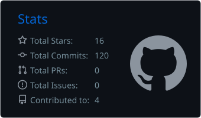
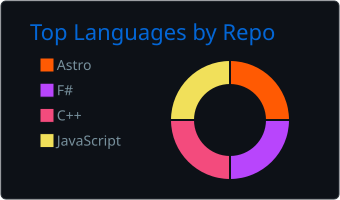

  

  

  

    <b>Embedded Software Engineer &nbsp;|&nbsp; Robotics &amp; Edge AI &nbsp;|&nbsp; Lifelong Learner</b>
  

  

    
    
    
    
    
    
    
  

---

## 🔧 Tech Stack

| Domain | Focus & Technologies |
| :--- | :--- |
| **Languages** | `C` · `C++17` · `Python` · `Verilog RTL` · `Shell` |
| **Hardware & Firmware** | `STM32 (Bare-metal)` · `FPGA (PCIe DMA / BAR0, video processing)` · `Motor PID` · `IMU / Kalman` |
| **Edge Compute & Systems** | `RK3568 / ARM64 Linux` · `RKNN NPU` · `Zero-copy Ring Buffer` · `IPC (Shared Memory)` |
| **Robotics & Autonomy** | `ROS 2 Jazzy` · `Nav2` · `Gazebo` · `SLAM / AMCL` · `RGB-D / Semantic Costmaps` |
| **Tools & Vision** | `CMake` · `Qt5 / PyQt6` · `OpenCV` · `Git` · `USB3 Vision` · `ModelSim / PDS` |

---

## 📦 Featured Projects

#### 🚙 [`FPGARACE_2026_Pango_3`](https://github.com/StellatoL/FPGARACE_2026_Pango_3) · Private

> **Four-camera FPGA bird's-eye view and RK3568 ADAS prototype**

- **FPGA video pipeline** — RGB565 frame reads, coordinate mapping, bilinear interpolation, gain and seam blending, and raster reordering; verified in simulation and synthesis.
- **ARM application** — Qt 5 video display with RKNN vehicle/traffic detection, conventional lane detection, short-term tracking, and on-screen ADAS alerts.
- **Current boundary** — The FPGA panorama and ARM application are still separate validation tracks; the complete camera-to-display board pipeline is pending integration and real-stream testing.

`Verilog` `C++17` `Qt5` `RKNN` `OpenCV` `ModelSim` · [Project README](https://github.com/StellatoL/FPGARACE_2026_Pango_3#readme) (access required)

#### 🚗 [`pango-fpga-2026`](https://github.com/StellatoL/pango-fpga-2026) · Private

> **FPGA + RK3568 PCIe heterogeneous intelligent traffic perception system**

- **System architecture** — A three-thread Qt5 concurrent pipeline (capture / inference / UI) driven by a producer–consumer queue that drops frames on overflow.
- **High-speed interconnect** — A zero-copy ring buffer built on FPGA PCIe DMA with a BAR0 register protocol.
- **Edge deployment** — End-to-end YOLOv5 + LPRNet licence-plate recognition on the RKNN NPU, with NEON acceleration and optimised NMS post-processing.

`Verilog` `C++` `Qt5` `PCIe DMA` `RKNN` `ARM64`

#### 🤖 [`vln-logistics-robot`](https://github.com/StellatoL/vln-logistics-robot) · Private

> **Vision-language-navigation (VLN) autonomous logistics robot**

- **ROS 2 architecture** — Six-package workspace with a hand-written modular Nav2 launch, switching seamlessly between SLAM mapping and AMCL localisation.
- **Chassis control** — STM32F407 mecanum-wheel firmware with four-wheel velocity-loop PID and wheel-odometry + IMU fused localisation.
- **Current stage** — Gazebo navigation, RGB-D perception and object-level semantic mapping are in simulation; the Jetson–STM32 ROS 2 serial bridge remains to be built.

`ROS 2 Jazzy` `Nav2` `SLAM` `STM32` `Gazebo` `RGB-D`

#### 🎯 [`RM2026_Buff_verify`](https://github.com/StellatoL/RM2026_Buff_verify) · Private

> **RoboMaster power-rune auto-aim and vision solver**

- **Vision solver** — OpenCV detection, coordinate transforms, ballistic compensation and ROS 2 integration; camera frames come from an external driver.
- **Target prediction** — A competition-rule state machine, sinusoidal angular-velocity fitting and an EKF-based pose filter support aiming at the rotating rune.

`C++17` `ROS 2` `OpenCV` `Ceres Solver` `State Machine`

#### 📡 [`FPGARACE_2025_Gowin_3`](https://github.com/StellatoL/FPGARACE_2025_Gowin_3)

> **Full-stack host software for a Gowin FPGA multi-protocol debugger**

- **High-speed streaming** — A PyQt6 + PyQtGraph oscilloscope reading a 25 Msps ADC, with time-domain waveforms and a live FFT spectrum.
- **Low-level transport** — A high-performance C++ Winsock UDP receiver forwarding data over shared memory (IPC).
- **Protocol decoding** — Hardware-level UART / I²C / SPI / PWM / CAN bus timing decode.

`PyQt6` `C++` `Winsock UDP` `Shared Memory` `FFT`

> Some project repositories are private. Their links are available to collaborators with access.

---

## 🌱 Engineering Focus & Roadmap

<b>✅ Core Capabilities</b>

 

- **Bare-metal firmware** — STM32 multi-loop velocity PID, Kalman attitude estimation, fused wheel-odometry + IMU localisation
- **Concurrency & data paths** — producer–consumer queues, ring buffers, PCIe DMA / BAR0 register interaction
- **Host tooling & instrumentation** — PyQt6 + PyQtGraph oscilloscope (time domain / FFT), high-speed C++ UDP receiver, shared-memory IPC
- **ROS 2 navigation stack** — modular hand-written Nav2 launch, SLAM / AMCL dual-mode switching, six-package workspace architecture

<b>🚧 Exploring & Building</b>

 

- **Edge AI acceleration** — RKNN model deployment and runtime profiling on RK3568
- **FPGA–ARM integration** — connect the four-camera panorama pipeline to the ARM application and validate real-stream latency on the board
- **Autonomous exploration** — coverage path planning with incremental replanning, frontier exploration, 45° slope point-cloud filtering on a real chassis
- **Semantic mapping** — YOLOv8 + RGB-D fusion into 2.5D semantic costmaps

---

## ⚡ Engineering Philosophy

> 💡 *"From STM32 PWM waveforms all the way up to a ROS 2 navigation stack — the most fascinating moment is when register states, timing constraints and neural-network inference finally line up on the same board."*

---

## 📊 GitHub Analytics

  
  

Cards are generated from activity visible to the profile workflow and refreshed daily.

 

### 🐍 Contribution Activity

  <picture>
    <source media="(prefers-color-scheme: dark)" srcset="https://raw.githubusercontent.com/StellatoL/StellatoL/output/github-contribution-grid-snake-dark.svg">
    <source media="(prefers-color-scheme: light)" srcset="https://raw.githubusercontent.com/StellatoL/StellatoL/output/github-contribution-grid-snake.svg">
    
  </picture>

---

## 📫 Let's Connect

  
  &nbsp;
  
  &nbsp;
  

    

  ⭐️ Thanks for stopping by · Always building, always exploring

